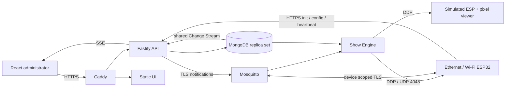

# Lightshow

A local, distributed show controller for WS2811 LEDs. A Raspberry Pi renders logical elements at a configurable 40 FPS and sends standard RGB DDP frames to ESP32 outputs. React provides device diagnostics, configuration, scene controls and pixel debugging. All runtime assets stay on your network.



## Requirements

- Node.js **24**, pnpm **10.20.0**, OpenSSL and Docker Compose v2.
- ARM64 Raspberry Pi OS with a supported 64-bit Pi (MongoDB 8 requires ARMv8.2-A; use Pi 5), or an ARM64/x86-64 development machine. Pi 4 cannot run the MongoDB 8 image; use a separate compatible MongoDB host in that case.
- Local DNS for `lightshow.home.arpa`, pointing to the Docker host. For a single development machine, add `127.0.0.1 lightshow.home.arpa` to its hosts file. ESPs need LAN DNS resolving the hostname to the Pi's LAN address.
- PlatformIO Core 6 for firmware builds; physical hardware is optional for simulator development.

## Start a private deployment

```sh
corepack enable
corepack prepare pnpm@10.20.0 --activate
pnpm install --frozen-lockfile
pnpm setup
docker compose up -d --build
pnpm trust
```

`pnpm setup` creates an ignored `.env`, random deployment credentials, MongoDB replication key, MQTT CA/server certificate and broker authorization file. The administrator password is stored locally in `.local/admin-password`; the `.env` contains its Argon2id hash. Set `LIGHTSHOW_SETUP_PASSWORD` before setup if you want to choose the password. Setup refuses to overwrite existing private configuration.

Trust **only the public certificate** `.secrets/trust/https-ca.crt` in your browser/OS, then visit **https://lightshow.home.arpa**. For macOS, import it into Keychain Access and explicitly trust it for SSL; on Raspberry Pi OS, install it under `/usr/local/share/ca-certificates/` and run `sudo update-ca-certificates`. Never distribute `.secrets/mqtt/ca.key` or Caddy's private CA data. The HTTPS root is created and persisted by Caddy's `tls internal`; MQTT uses a separate deployment CA. `pnpm trust` exports a combined public bundle for firmware.

Check service health with `docker compose ps`. Ports 80/443 and TLS MQTT 8883 are exposed. MongoDB, API, engine health and static UI remain on the private Compose network. Caddy's HTTP port redirects to HTTPS. The broker's persistent data and credential hashes live in the ignored `.secrets/broker` directory; back it up along with Docker volumes.

## First complete show, without hardware

For an automated development example, run `pnpm demo` after startup and CA export. It enrolls the default simulator, grants the current engine address, creates a mapped element with four skipped pixels, activates an orange pulse and verifies received frames. It creates the named `demo-yard` / `demo-pulse` resources through the API. Run it on a development deployment. The manual workflow is below.

1. Sign in and open **Access**. Generate an enrollment credential for `sim-yard-1`.
2. Put the credential in the private `.env` as `SIM_PROVISIONING_TOKEN='…'`.
3. Run `docker compose --profile simulator up -d --build esp-simulator`.
4. The controller appears on **Dashboard**, with five-second heartbeats.
5. Open **Devices**, select it and add the engine's IPv4 address to its permitted DDP sources. Find it with `docker compose exec show-engine hostname -i` (for physical ESPs use the Docker host's LAN IP, because bridge traffic is NATed). A new device starts with an **empty allowlist**.
6. In **Elements**, create `yard-1` with 100 logical pixels and one segment: select the simulator, output index 0, physical start 0, physical count 100, logical start 0, no skips. For the documented skipped example, use logical count 196, physical count 200 and skips `4,20,102,188`, after increasing the output to 200 pixels.
7. In **Scenes**, create a scene, add a solid or rainbow effect targeting the element, save and activate it.
8. View the simulated LEDs at **http://127.0.0.1:4090** or inspect `/pixels` there. This development-only viewer exposes pixels and diagnostics, never credentials. Its host port binds to loopback.
9. Use **Lighting debugger** to override an element, identify an output or test one pixel. **Restore scene control** removes overrides. Skips stay black in every case.

The simulator persists its identity in a Docker volume and uses the device Bearer token on subsequent boots. It validates both HTTPS and MQTT certificates. Compose supplies an internal `SIM_MQTT_URL` because its HTTPS DNS alias resolves to Caddy, while MQTT is a separate container.

For several concurrent simulators, use separate containers (each can use UDP 4048), unique hardware identities, persistent state files/volumes, enrollment credentials and inspection host ports. On one host process namespace, assign distinct DDP ports through device configuration before starting each additional simulator. See [provisioning](docs/provisioning.md).

## Firmware

Both initial targets use the original dual-core ESP32:

```sh
pio run -d firmware/esp32 -e wt32-eth01 -e esp32dev
```

This builds with public example settings. To run hardware, generate the ignored private firmware header with the deployment's public CA bundle and a hardware-bound enrollment credential, then flash the corresponding target. Read [firmware.md](docs/firmware.md) and [provisioning.md](docs/provisioning.md) first. ESP hardware identity is `esp32-` followed by the base MAC in lowercase without separators, for example `esp32-aabbccddeeff`. No real device identity or network credential is embedded in this repository.

## Development and verification

Use tabs, double quotes and no optional JavaScript/TypeScript semicolons. Leave blank lines between declarations, methods and logical statement groups. `pnpm format` applies the shared Prettier settings and preserves these blank lines; `.editorconfig` supplies editor defaults. Firmware and native C++ tests follow `.clang-format` (clang-format 20). YAML and Markdown use spaces where their syntax requires them.

```sh
pnpm typecheck
pnpm test
pnpm build
pnpm format:check
pnpm test:firmware
# Full stack must be healthy and pnpm trust completed:
bash scripts/integration.sh
# Builds both boards; no physical upload:
pio run -d firmware/esp32 -e wt32-eth01 -e esp32dev
```

Integration tests create temporary device/scene records and clean them up; they activate and stop a show, so use a development deployment. They exercise real MongoDB, HTTPS, Mosquitto authorization, the simulator and DDP. Tests require the generated `.local/admin-password` to match the current administrator hash.

`pnpm dev:api`, `pnpm dev:engine` and `pnpm simulator` run local processes. Override Docker-only database/broker hostnames and CA paths with a private `.env.local` or process environment; database ports are intentionally unpublished by default. `pnpm dev:ui` starts Vite. For cookie authentication, route Caddy's UI upstream to the development server while keeping the browser on the configured HTTPS origin. `pnpm build` creates the static production UI; backend containers run checked TypeScript through the pinned `tsx` loader on Node 24.

API documentation is available at **/v1/docs/** after login. Scripts can use separately generated administrative Bearer tokens; device tokens cannot authorize administrator routes.

## Operations

- Provisioning and credential recovery: [docs/provisioning.md](docs/provisioning.md).
- Ownership, mappings, protocols and assumptions: [docs/architecture.md](docs/architecture.md).
- REST and SSE contract: [docs/api.md](docs/api.md).
- Boards, pins, timing and hardware checks: [docs/firmware.md](docs/firmware.md).
- Tested behavior and physical validation checklist: [docs/validation.md](docs/validation.md).

Normal operation requires no public internet. Pre-download images and dependencies during provisioning; transfer with `docker save` / `docker load` for isolated installations. Local DNS and accurate LAN time remain necessary. Firmware uses a configured LAN NTP host and a provisioning timestamp, with full TLS validation. If you retain the default NTP hostname, run a LAN NTP service on the Pi (for example chrony on the host); Compose does not provide an NTP service.

Back up MongoDB, broker security data, `.env` and Caddy volumes securely. `docker compose down` preserves volumes; never use `down -v` as routine maintenance. An empty or changed Caddy CA requires exporting and reinstalling public trust. MQTT leaf certificates expire after 825 days; renew them using the retained private MQTT CA before expiry and restart Mosquitto. Documented root rotation requires reprovisioning trust.

If a device appears offline, inspect `docker compose logs api mosquitto show-engine`, DNS and CA trust. If heartbeats work but pixels stay black, check the DDP allowlist, correct engine source IP, output index/count, device listening mode and UDP routing. Firmware GPIO restrictions deliberately reject Ethernet, flash, input-only and boot-strapping pins. A stale configuration conflict means another editor changed the version; select the device again and retry.

MIT licensed. Physical power distribution, level shifting, common grounds and weatherproofing remain installation responsibilities.
